<p align="center">
  
</p>

<p align="center">
  <a href="https://github.com/ekupekuAI/AISecurity26228/releases"></a>
  
  
  
  
</p>

<p align="center">
  <a href="https://skillicons.dev"></a>
</p>

<p align="center">
  <a href="https://github.com/ekupekuAI/AISecurity26228/releases">
    
  </a>
</p>

> [!IMPORTANT]
> **There is no public hosted demo — by design.** TrustVision is an **air-gapped, offline** system
> for defence use. To try it, download `TrustVision-Setup.exe` from
> **[Releases](https://github.com/ekupekuAI/AISecurity26228/releases)** (zero install, runs offline), or
> run it from source with the [quickstart](#-quickstart) below.
> Demo login in the Windows app: **`admin` / `TrustVision#2026`** — or use the no-password read-only session.

---

## 🛡️ What it is

**TrustVision answers one hard question: can you trust this computer-vision pipeline?**

Not just the model file — the **data** it learned from, the **model** itself, and the **predictions** it
makes. You hand it an asset; it runs a battery of checks and returns **one clear verdict** —
`ACCEPT`, `REVIEW` or `QUARANTINE` — with every step written to a **signed, hash-chained audit log**
that cannot be quietly edited.

Built by **Team Patriots** for **Smart India Hackathon 2026, problem statement SIH26228**
(MoD · Indian Army, DGIS): a single offline layer that inspects data, models and inference
outputs, binds them together cryptographically, and gives an evidence-backed decision.

<p align="center">
  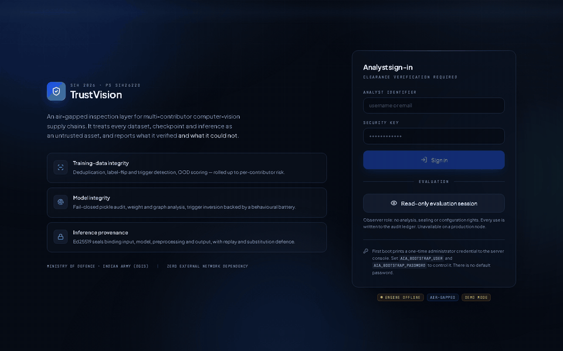
  <br><sub><i>Walkthrough of the current console — sign-in → node verdict → dataset inspection → tamper detection → signed ledger → model passport → analytics.</i></sub>
</p>

---

## ✨ Features

| | Feature | What it does |
|---|---|---|
| 🗂️ | **Dataset integrity** | Exact (SHA-256) and near-duplicate (pHash + BK-tree) floods, label flips via k-NN in feature space, backdoor triggers recovered and *shown*, OOD samples (Mahalanobis), corrupt files, unsafe archives (Zip-Slip, bombs, symlinks), per-contributor risk |
| 🧠 | **Model integrity** | Pickle opcodes read **without executing them** (fails closed on broken streams), ONNX graph inspection, weight anomalies, a behavioural trigger battery, Neural Cleanse to confirm |
| 🔏 | **Inference provenance** | Input hash + model hash + config + prediction + nonce → RFC 8785 canonical bytes → SHA-256 → Ed25519. Verify returns `VERIFIED`, `TAMPERED` (names the field), `FORGED` or `REPLAYED` |
| 🌗 | **Distribution shift** | MMD with a permutation test plus per-feature KS / PSI; separates environmental drift from tampering |
| ⚖️ | **Governance** | Fixed thresholds (`ACCEPT < 30 ≤ REVIEW < 70 ≤ QUARANTINE`), mandatory overrides, **per-asset** decisions, and **no silent downgrade** — a check that could not run caps the result at `REVIEW` |
| 📜 | **Signed audit ledger** | Append-only SQLite chain; every block hashed to the previous one and Ed25519-signed; DB triggers refuse `UPDATE`/`DELETE` |
| 🪪 | **Model passport (AI-BOM)** | A portable, signed record of one artefact's assessment that carries its own public key — verifiable offline on any node |
| 📡 | **Live monitoring** | Read-only sentinel agents sweep the node's own telemetry for threats and tampering |
| 👥 | **Per-user workspaces** | Each operator's uploads and dashboard are isolated; roles, CSRF, scrypt passwords, idle timeouts |
| 🔌 | **Degraded mode, honestly labelled** | If the Python engine is down the gateway runs a reduced fallback — marked degraded and **never** `ACCEPT` |

---

## 📸 Screenshots

<table>
  <tr>
    <td width="50%">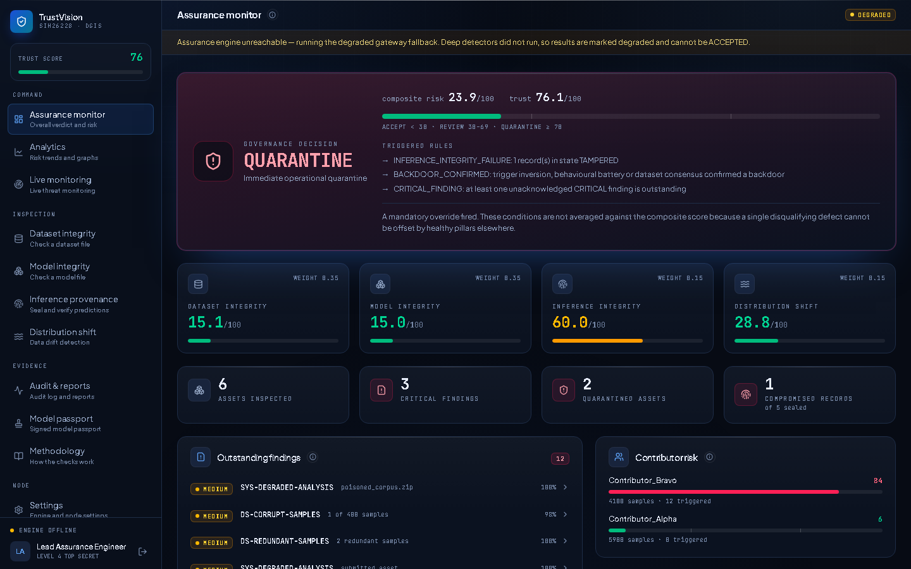<br><sub><b>Assurance monitor</b> — node verdict, the override rules that fired, and risk per pillar.</sub></td>
    <td width="50%">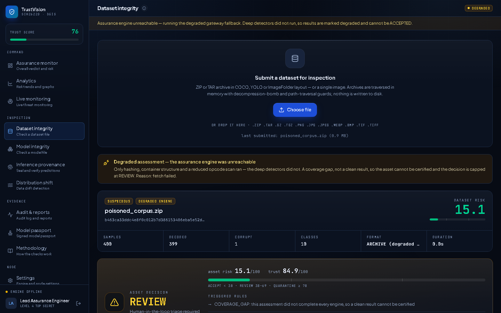<br><sub><b>Dataset integrity</b> — a real upload of the bundled poisoned corpus, honestly capped at REVIEW when the engine is offline.</sub></td>
  </tr>
  <tr>
    <td width="50%">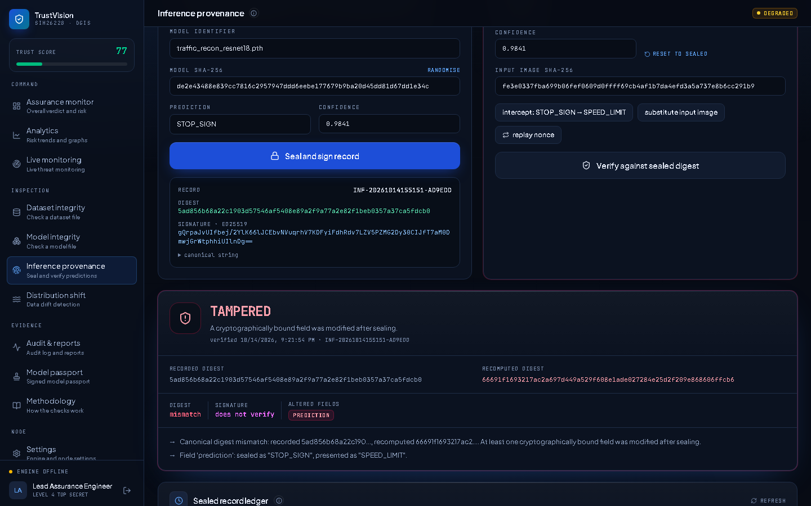<br><sub><b>Inference provenance</b> — seal a prediction, change it, and verification names the altered field.</sub></td>
    <td width="50%">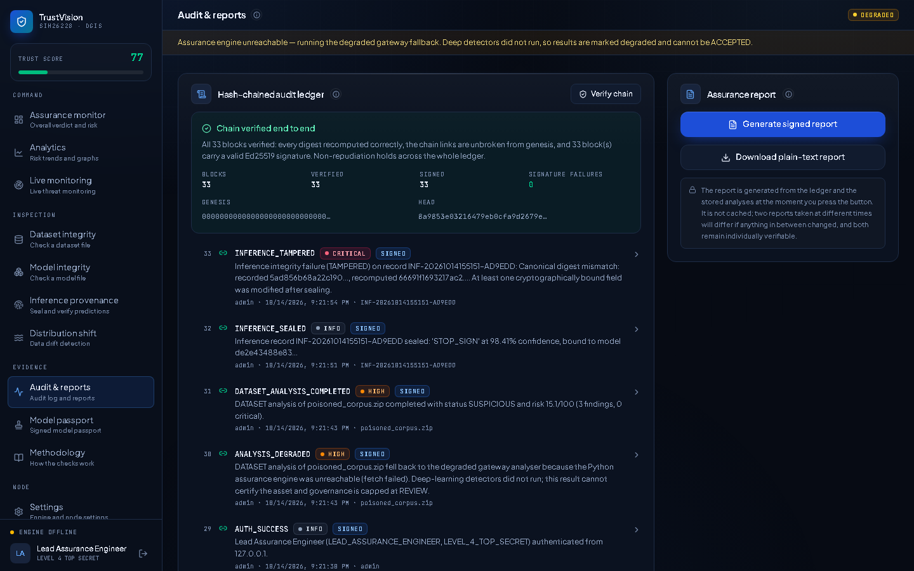<br><sub><b>Audit ledger</b> — every block recomputed and its Ed25519 signature checked.</sub></td>
  </tr>
  <tr>
    <td width="50%">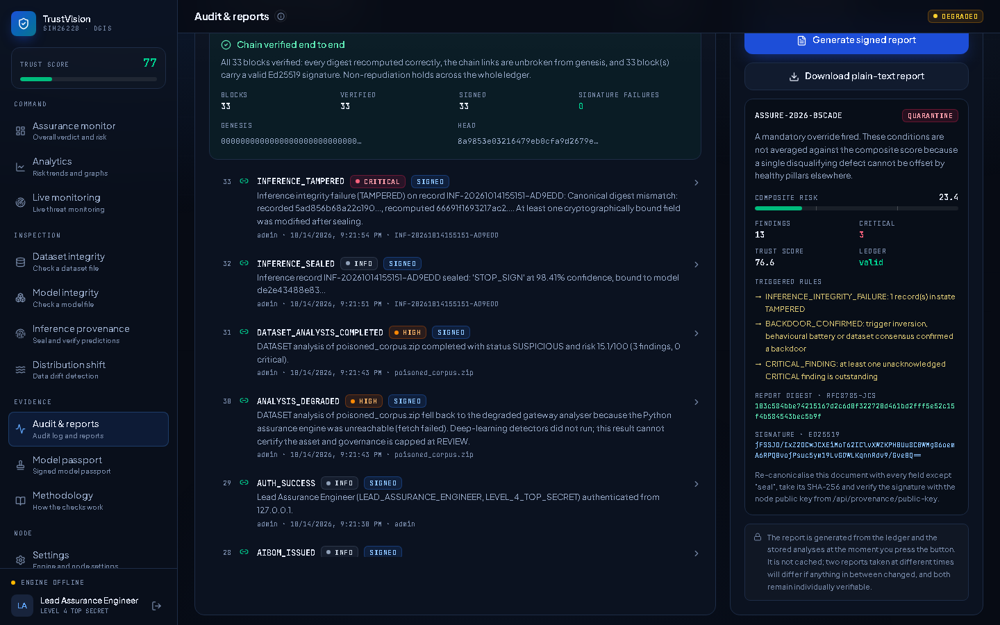<br><sub><b>Signed assurance report</b> — canonicalised, hashed and signed so a third party can verify it.</sub></td>
    <td width="50%">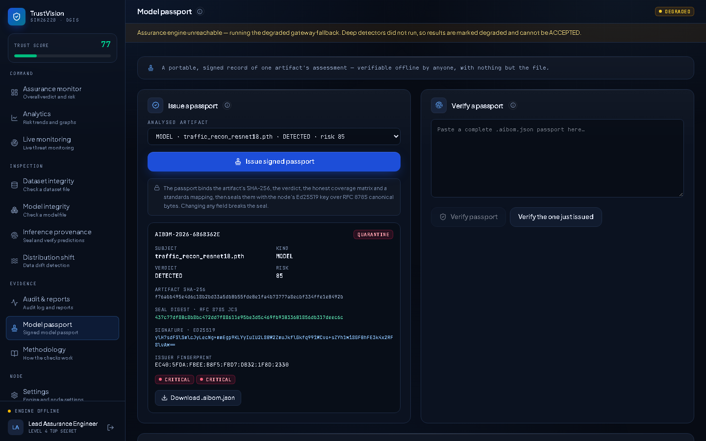<br><sub><b>Model passport</b> — a signed AI-BOM for one artefact, verifiable offline.</sub></td>
  </tr>
  <tr>
    <td width="50%">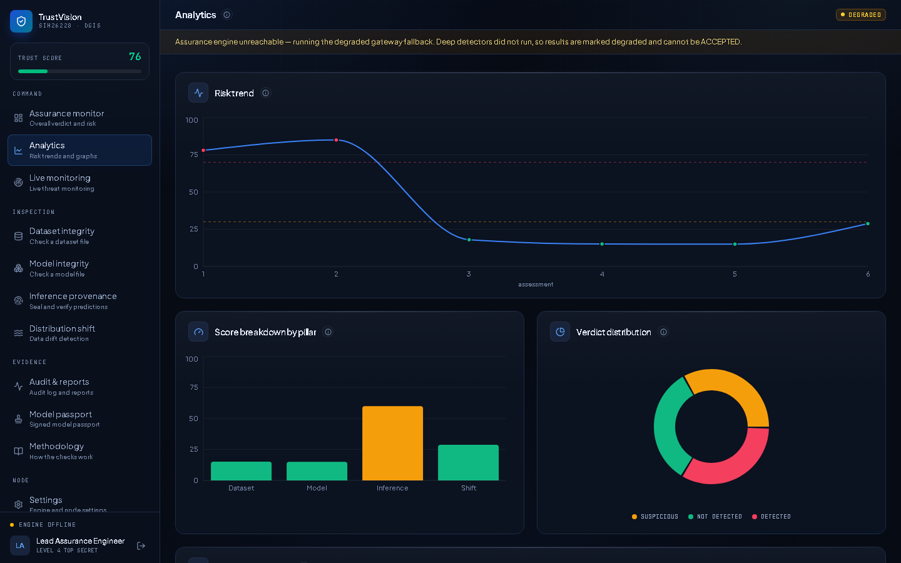<br><sub><b>Analytics</b> — risk trend, pillar breakdown and verdict mix.</sub></td>
    <td width="50%">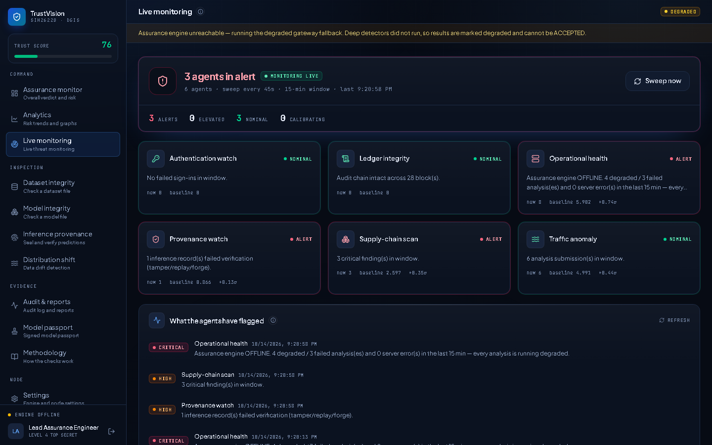<br><sub><b>Live monitoring</b> — sentinel agents and their alerts.</sub></td>
  </tr>
</table>

<details>
<summary><b>Sign-in screen</b></summary>
<br>
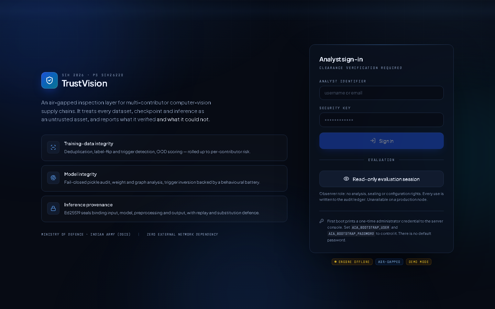
</details>

<sub>Screenshots are of this version running with the Python engine offline (degraded mode) and the built-in evaluation fixture loaded from <b>Settings → Load evaluation fixture</b>.</sub>

---

## 🧭 The problem

<p align="center">
  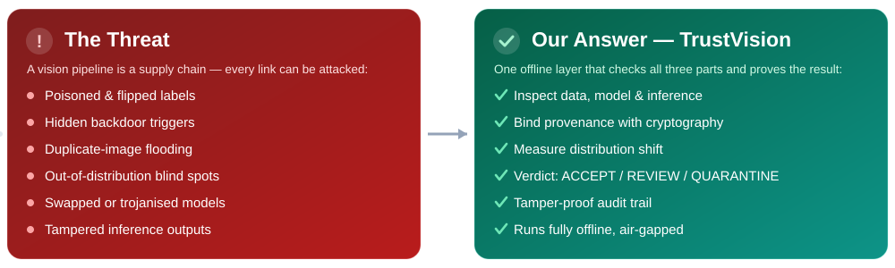
</p>

Defence vision systems take data from many outside contributors, use models from third-party vendors,
and send live results to decision-makers. Any link can be poisoned. SIH26228 asks for one offline
software layer that inspects all three and leaves a full audit trail.

## 🔄 How it works

<p align="center">
  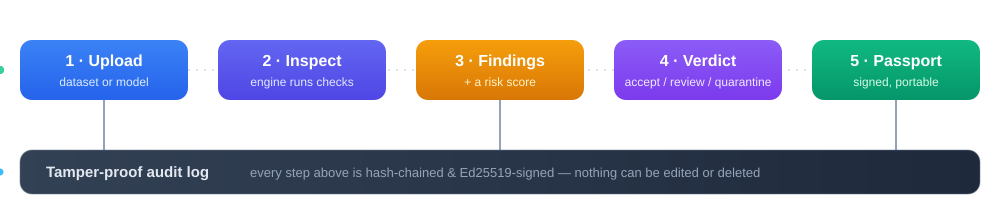
</p>

Sign in, upload a dataset or model, and the checks run as a **background job** with live progress, so a
large file never looks frozen. You get findings, a risk score and a verdict, and can export a signed
passport. Every step lands in the audit log.

<p align="center">
  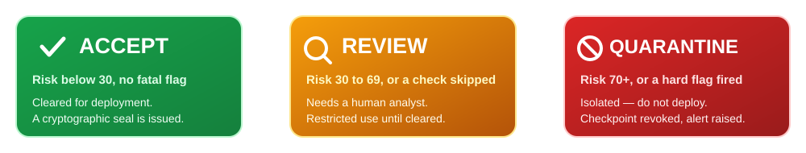
</p>

---

## 🏗️ Architecture

Two programs on one machine, talking only over `localhost`: a **Node/Express gateway** (console,
database, roles, signed audit log) and a **Python engine** (every real detector). The engine never
listens beyond loopback, and the engine URL is refused at boot if it points at a public address.

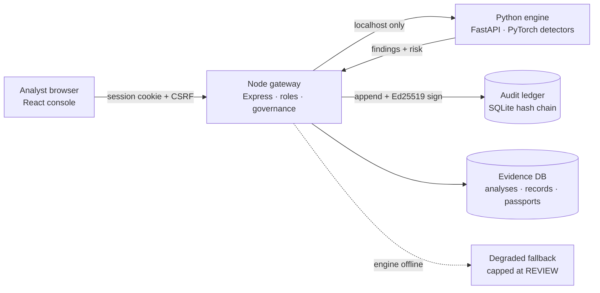

<p align="center">
  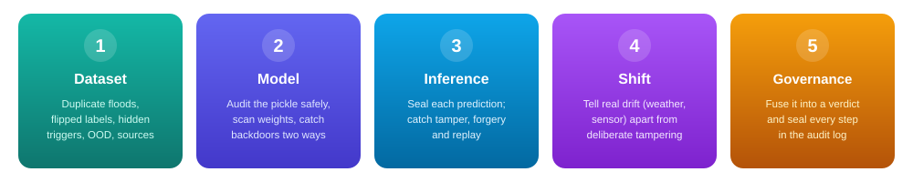
</p>

---

## 🚀 Quickstart

### Windows app (zero install, fully offline)

1. Download **`TrustVision-Setup.exe`** from [Releases](https://github.com/ekupekuAI/AISecurity26228/releases)
   (if Google warns it "can't scan large file", choose **Download anyway**).
2. Run it → pick a folder → it self-extracts a **`TrustVision`** folder.
3. Double-click **`TrustVision.vbs`** (or `Add to Desktop.vbs` for an icon). The app is unsigned, so on
   first launch choose **More info → Run anyway**.
4. Sign in as **`admin` / `TrustVision#2026`** (change it in Settings) or use the read-only session.
   The engine keeps warming up for a minute or two on first run; the top bar shows when it is ready.
5. Stop it with **`Stop TrustVision.vbs`**.

Build that bundle yourself: `powershell -ExecutionPolicy Bypass -File deploy\windows\build-windows-app.ps1`

### From source

Needs **Node.js ≥ 22.5** and **Python ≥ 3.10**.

```bash
npm install
python -m pip install -r ml-engine/requirements.txt
cp .env.example .env            # optional: every value has a safe default
```

Optionally stage the reference backbone once (needs network; copy it to the offline node afterwards).
Without it, embedding-based checks still run but are reported at reduced confidence:

```bash
python ml-engine/scripts/provision_backbone.py
```

Run the engine and the console in two terminals:

```bash
npm run ml      # Python engine on 127.0.0.1:8000
npm run dev     # gateway + console on http://127.0.0.1:3000
```

Set `AIA_BOOTSTRAP_USER` / `AIA_BOOTSTRAP_PASSWORD` to choose the first admin; otherwise a one-time
password is printed to the terminal on first boot. With `AIA_DEMO_MODE=true`, **Settings → Load
evaluation fixture** loads the SIH case-study scenario so every page has data.

> No engine? The console still runs — analyses use the degraded gateway fallback and say so on every result.

### Docker (single air-gapped node)

```bash
cp deploy/.env.example .env     # set AUTH_SECRET (and the bootstrap admin)
cd deploy
docker compose --env-file ../.env up -d --build
```

The console is served on `http://127.0.0.1:3000` from a read-only, capability-dropped container with the
evidence kept in the `assurance-data` volume. For a shared HTTPS deployment (Caddy, Cloudflare Tunnel)
see **[DEPLOY.md](DEPLOY.md)**.

### Tests

```bash
npm test          # gateway suite (node:test) — 74 tests; 2 skip unless the engine is running
npm run test:py   # Python engine suite (pytest), incl. ground-truth detection tests
npm run verify    # typecheck + both suites
```

---

## ⚙️ Configuration

Copy `.env.example` to `.env`. **Nothing is required for a local demo** — every value has a safe default.
Production refuses to start on an unsafe configuration.

| Variable | Default | What it does |
|---|---|---|
| `NODE_ENV` | `development` | `production` enables the fail-closed configuration audit |
| `HOST` / `PORT` | `127.0.0.1` / `3000` | Where the console listens. Loopback by default |
| `APP_URL` | — | Public origin of the console; required when `HOST` is not loopback |
| `AUTH_SECRET` | auto-generated in `data/keys/` | **Production:** session signing secret, ≥ 32 chars. Generate: `node -e "console.log(require('crypto').randomBytes(48).toString('base64url'))"` |
| `AIA_BOOTSTRAP_USER` / `AIA_BOOTSTRAP_PASSWORD` | — | First administrator. If unset, a one-time password is printed on first boot |
| `AIA_SERVICE_TOKEN` | — | Shared gateway→engine secret; only needed when they run on different hosts |
| `ML_SERVICE_URL` | `http://127.0.0.1:8000` | Engine URL. Must be loopback or a private range — public addresses are refused |
| `AIA_ENGINE_ALLOWED_HOSTS` | — | Extra engine hostnames for an intentional intranet split |
| `AIA_ENGINE_TIMEOUT_MS` | `900000` | Engine request timeout (trigger inversion can take minutes) |
| `AIA_SESSION_TTL` / `AIA_SESSION_IDLE` | `28800` / `2700` | Absolute and idle session lifetime, seconds |
| `AIA_MAX_UPLOAD_BYTES` | `2147483648` | Upload size cap |
| `AIA_TRUST_PROXY_HOPS` | `0` | Reverse proxies in front; `0` ignores `X-Forwarded-For` |
| `AIA_DEMO_MODE` | `true` | Read-only demo login + evaluation fixture. Refused in production |
| `AIA_TORCH_THREADS` | `4` | CPU threads for PyTorch |
| `AIA_ALLOW_MODEL_EXECUTION` | `true` | `false` = structural-only model checks (no behavioural battery) |
| `AIA_NEURAL_CLEANSE_TIMEOUT` | `600` | Seconds budgeted for trigger inversion |
| `AIA_BACKBONE_WEIGHTS` | — | Path to the staged backbone from `provision_backbone.py` |
| `AIA_ALLOW_WEIGHT_DOWNLOAD` | `false` | Keep `false` on an air-gapped node |
| `AIA_NODE_ID` | `AIR-GAPPED ASSURANCE NODE` | Name printed on reports and audit blocks |

The full list, with comments, is in [`.env.example`](.env.example). **No third-party API keys are used** —
the system makes no outbound calls.

---

## 🎯 Does it catch things?

Scored against a labelled corpus built from real CIFAR-10 data with a genuinely fine-tuned backdoor
(99.99% attack success, 85.9% clean accuracy — high enough to pass ordinary validation).

| Asset | Ground truth | Verdict |
|---|---|---|
| `backdoored_model.pth` | BadNets corner trigger → class 0 | **DETECTED** → QUARANTINE |
| `clean_model.pth` | Clean, ~86% accuracy | Not a backdoor → ACCEPT |
| `malicious_model.pth` | `os.system` via pickle | **DETECTED**, risk 100, never deserialised |
| `nullifai_model.pth` | Payload behind a broken stream | **DETECTED**, risk 100 |
| `backdoored_model.onnx` | Same backdoor, ONNX | **DETECTED** via onnxruntime |
| `poisoned_corpus.zip` | 36 triggers, 34 floods, 28 flips | **DETECTED**, triggers recovered |
| `clean_corpus.zip` | Clean CIFAR-10 | ACCEPT |

These are full-engine results. Reproduce them with `python ml-engine/scripts/make_demo_assets.py`, then
`python -m pytest ml-engine/tests/test_ground_truth.py -v`.

---

## 🆕 What's new in this version

| Area | Before (`f0526c9`) | After |
|---|---|---|
| Empty-node verdict | A fresh node with nothing analysed showed a green **ACCEPT — "authorised for operational deployment… every engine completed its assessment"** | Returns **REVIEW** with a `NO_EVIDENCE` rule: *nothing has been assessed, so there is no evidence to certify* (regression test added) |
| Sidebar trust score | Showed a green **100** before anything was assessed | Shows **—** until there is evidence, as the component always intended |
| README | Static banner, no screenshots of the console | Animated banner (respects reduced-motion), real screenshots and a walkthrough GIF of the current console, architecture diagram, Docker quickstart, full configuration table |

Verified for this version: typecheck clean, production build passes, gateway suite 72 pass / 2 skipped
(engine-only). With the engine offline, the console flows — sign-in (admin and read-only), evaluation
fixture, dataset upload, inference seal → tamper → verify, chain verification, signed report, passport
issue → verify — were exercised in the browser, and model and distribution-shift analysis through the API.

## 🔭 Future development

- **Degraded-mode pickle scan:** the gateway fallback only resolves `GLOBAL` opcodes, so a protocol-4+
  pickle (which uses `STACK_GLOBAL`) is not flagged when the engine is offline. The result is still
  capped at `REVIEW`, never `ACCEPT`, but resolving `STACK_GLOBAL` would close the gap.
- Gradient-based trigger inversion for ONNX and safetensors (today they get the behavioural battery only).
- Detection of clean-label poisoning (Poison Frogs, Sleeper Agent) and input-aware/warping backdoors (WaNet, BppAttack).
- MFA / smart-card sign-in, and a multi-node ledger for more than one assurance node.
- A code-signed Windows build so the first launch has no SmartScreen prompt.

---

## ⚠️ Limitations

- Clean-label poisoning and input-aware/warping backdoors are out of scope (see above).
- Neural Cleanse only confirms the behavioural battery; it is not trusted on its own.
- The degraded fallback is shallow by design and always capped at `REVIEW`.
- Single node: the audit log is one signed SQLite chain, not a distributed ledger.
- Authentication is local only (scrypt passwords, server-side sessions); no SSO or MFA.

---

<details>
<summary><b>📁 Project structure</b></summary>

```
server.ts              Gateway entry point (boot-time config audit, ledger verification)
server/
  routes/              auth · analysis · inference · governance · aibom · sentinel · system
  db/                  SQLite schema, repositories, append-only audit ledger
  security/            sessions, CSRF, scrypt, Ed25519 keyring, guards
  provenance/          RFC 8785 canonicalisation, sealing, AI-BOM passports
  analyzers/           degraded gateway fallback
  sentinel/            read-only monitoring agents
src/                   React 19 console (pages, Radix UI primitives, Motion)
ml-engine/             Python engine
  security/            pickle opcode audit, archive guards
  vision/              pHash, embeddings, label noise, OOD, trigger recovery
  modelscan/           ONNX/Torch inspection, behavioural battery, Neural Cleanse
  analyzers/           dataset, model, shift and risk engines
  provenance/          canonicalisation and Ed25519 signing
  tests/               pytest suite incl. ground-truth detection tests
demo-assets/           clean / poisoned / COCO demo corpora
deploy/                Docker, Caddy, systemd, windows/ (zero-install app builder)
docs/                  README graphics and screenshots
```

</details>

<details>
<summary><b>👥 Team Patriots &amp; contributions</b></summary>
<br>

| # | Member | Role &amp; contribution |
|---|---|---|
| 1 | **Ekansh** | Team Leader · Integrator &amp; Developer |
| 2 | **Shivasai** | Co-Developer · Backend Integration |
| 3 | **Snehitha** | Research &amp; Documentation · Complete Research |
| 4 | **Meheq** | Ideology &amp; Documentation · Co-Researcher |
| 5 | **Siddharth** | UI/UX · Deep Researcher &amp; Architect |
| 6 | **Sheshir** | Quality Assurance &amp; Testing · End-to-End |

</details>

<details>
<summary><b>📚 References — methods actually implemented</b></summary>
<br>

**Backdoor detection** — `modelscan/`, `vision/triggers.py`
- Gu et al., [*BadNets*](https://arxiv.org/abs/1708.06733) (2017) — the corner-patch trigger family the behavioural battery replays.
- Chen et al., [*Targeted Backdoor Attacks (Blended)*](https://arxiv.org/abs/1712.05526) (2017) — the blended-overlay probe.
- Wang et al., [*Neural Cleanse*](https://doi.org/10.1109/SP.2019.00031) (IEEE S&P 2019) — per-class trigger inversion, used only to corroborate.
- MITRE ATLAS [*AML.T0010 — ML Supply-Chain Compromise*](https://atlas.mitre.org/techniques/AML.T0010).

**Dataset integrity** — `analyzers/dataset_analyzer.py`, `vision/`, `ingest/`
- Northcutt et al., [*Confident Learning*](https://arxiv.org/abs/1911.00068) (JAIR 2021) — k-NN basis for label-manipulation detection.
- Lee et al., [*Mahalanobis OOD detection*](https://arxiv.org/abs/1807.03888) (NeurIPS 2018).
- Ledoit & Wolf, *Well-conditioned covariance estimation* (JMVA 2004) — the shrunk covariance the OOD score uses.
- Perceptual hashing (pHash) indexed in a BK-tree for near-duplicate flooding.

**Distribution shift** — `analyzers/shift_analyzer.py`
- Gretton et al., [*A Kernel Two-Sample Test*](https://jmlr.org/papers/v13/gretton12a.html) (JMLR 2012) — MMD with a permutation test.

**Serialisation, provenance & security** — `security/pickle_audit.py`, `provenance/`, `server/`
- ReversingLabs, *nullifAI* (2025) — the broken-pickle-stream evasion the opcode audit fails closed on.
- [RFC 8785](https://www.rfc-editor.org/rfc/rfc8785) (JCS) · [RFC 8032](https://www.rfc-editor.org/rfc/rfc8032) (Ed25519) · [RFC 7914](https://www.rfc-editor.org/rfc/rfc7914) (scrypt).
- CWE [-502](https://cwe.mitre.org/data/definitions/502.html), [-22](https://cwe.mitre.org/data/definitions/22.html), [-409](https://cwe.mitre.org/data/definitions/409.html), [-59](https://cwe.mitre.org/data/definitions/59.html) — the upload/archive weaknesses guarded against.

</details>

<p align="center">
  
</p>
